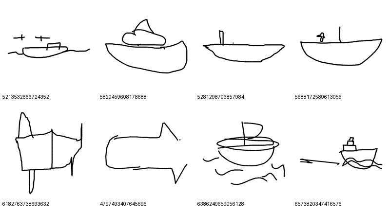
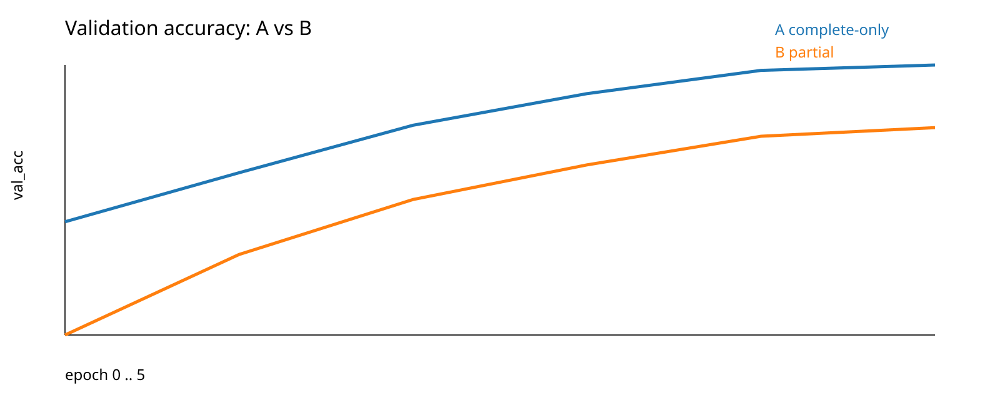
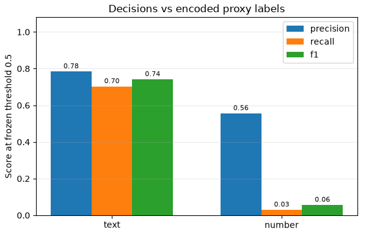

# More Than Meets the AI

A multiplayer drawing game for CSC173, inspired by skribbl.io. Players race to recognize a shared sketch while the Guesser evaluates the canvas and the Referee provides advisory writing alerts.

**[Open the presentation](presentation/More-Than-Meets-the-AI.html)** · [Presentation notes and sources](presentation/README.md) · [Play the game](https://mtmai.yashindo.syn-forge.com/)

| Guesser | Referee |
| --- | --- |
| Learns to classify sketches across 345 Quick, Draw! categories. | Estimates evidence of text and numbers in ATYPICT sketches. |
| Complete and partial drawing training runs are compared. | Warnings are advisory; players judge whether writing is a prohibited clue. |

The Guesser chart shows validation on **completed drawings during training**, not real-game accuracy.

The Referee final chart compares decisions against **encoded proxy labels** at threshold 0.5: text F1 is 0.74 and number F1 is 0.06. Its correspondence to deployed weights and real-game warning accuracy are unverified. See the [presentation notes](presentation/README.md) and [Referee repair audit](docs/referee/REPAIR-AUDIT.md) for scope and limitations. The sections below include dated milestone notes; consult the linked component guides for subsequent work.

**Implemented Individual milestone (verified 7 November 2026)**. The NestJS remote adapter provides shared rooms for Individual play, and the browser-local adapter is a demo. Compose packages the web app, room API and optional inference service. Both AI providers default to unavailable. The optional profile supports a Guesser smoke test and Referee fixtures. Remote Team play, the team's trained model integrations and research evaluation have separate handoffs.

**The default mode is individual free-for-all, not a team game.** One player draws on a shared canvas while every other player guesses for their own score and races the same AI guesser. The drawer and guessers are individual competitors, not teammates. Drawer duty rotates through the room's players; the highest finalized individual total wins.

Each human guesser can solve the prompt independently. A first correct human guess does not end the drawing turn: drawing, remaining human guesses and eligible AI attempts continue. The turn ends when all eligible human guessers have solved or the timer expires. An AI solve stops its own further guessing, while humans can still solve for points. Human and AI guessers receive the same official word-length and revealed-letter hints; AI answer text stays hidden until reveal/replay.

Current human-v1 scoring awards personal raw speed points and capped, normalized drawer recognition from human solves. Human AI modifiers stay zero while inference is unavailable. The separate ai-benchmark-v1 ledger prepares AI round points and a committed total with coverage: eligible no-solve is zero, unavailable is null/unscored, and AI points do not determine human winners or drawer recognition. Future before/after-AI tuning remains disabled and unvalidated. See [the backend scoring implementation plan](docs/BACKEND-SCORING-PLAN.md).

Any visual strategy is allowed; written answer clues are prohibited, while incidental writing on objects is allowed. A separate transformer referee flags suspected written clues. Flags are advisory, and players resolve disputes.

## Free Draw

`/free-draw/` is the private solo drawing workspace. Enter through **Free Draw** below the homepage room-code controls; no player profile or room is required. It has no rounds, countdown or score. Switch between open drawing and a searchable model-class prompt, and independently toggle the Guesser, advisory Referee and existing attention overlay. Every prediction remains visible with confidence and threshold status for the current visit.

The workspace uses the configured inference service, not demo predictions. Drawing remains available during outages. Every visit starts fresh; drawings and controls are not saved. See [Free Draw behavior, API and validation](docs/FREE-DRAW.md).

## Canvas frontend

The application is in [apps/web](apps/web). It retains the approved create/invite/join/lobby flow, drawing tools and browser-local demo adapter. Its remote adapter connects to the [NestJS room backend](apps/api/README.md) for authenticated guest sessions, shared lobby and drawing state, private selection from three words, human scoring, round rotation and final standings. Human scoring remains human-v1 with AI modifiers zero. The AI benchmark records unavailable outcomes as unscored and exposes committed totals and coverage. Remote Team settings and starts are deferred to the [Team gameplay plan](docs/TEAM-GAMEPLAY-NEXT-PLAN.md).

See the [frontend run/build instructions](apps/web/README.md), [implementation plan](docs/FRONTEND-IMPLEMENTATION-PLAN.md), and [temporary UI scope](docs/FRONTEND-BASE-SCOPE.md). Build `apps/web` with `npm run build`; its `out/` directory can be served by a static host. No hosting provider has been configured by this implementation.

The separate follow-up scopes are [Team gameplay](docs/TEAM-GAMEPLAY-NEXT-PLAN.md) and [real AI inference](docs/AI-INTEGRATION-NEXT-PLAN.md). Current local verification is recorded in [the validation report](docs/FRONTEND-VALIDATION.md).

The results/chat correction adds ranked avatar cards, a clearer recap, green correct confirmations and chat following. Fresh matches use private selected-target history with a 348-word catalogue. See [the correction checks and testing notes](docs/FRONTEND-VALIDATION.md).

Deploy the web and room API with Compose in memory mode or with an external PostgreSQL database. The optional AI profile provides a pinned smoke-test Guesser and an independent Referee fixture. [Deployment runbook](deploy/README.md)

Main-branch CI is configured to test and publish web/API images to GHCR with matching commit tags. The VPS can pull these images without rebuilding; rollout remains manual and retains PostgreSQL data. See [CI and registry publishing](docs/CI.md) and [the pull-only node1 procedure](deploy/README.md#pull-prebuilt-ghcr-images-on-node1). The workflow must be pushed and pass on GitHub before its images exist.

## Guesser data and evaluation

The agreed [models layout](models/README.md) separates Guesser data, training, inference, evaluation and checkpoints from Referee work. The [data package](models/guesser/data/README.md) uses Python 3.13 and uv: numbered stages download/clean/sample, prepare splits, optionally preview and export with one data audit. Timed image creation uses the shared foreground/edges preprocessors; no approvals or freeze step are required. See the [runbook](models/guesser/data/RUNBOOK.md).

The [training guide](models/guesser/training/README.md) covers Windows/Linux setup, the required prepared data, GPU checks, A/B runs, resume and comparison. Lightning/timm training and PyTorch batching are implemented; the initial pipeline was run on Windows according to the training owner, while Linux GPU training still requires validation. The [evaluation workspace](models/guesser/evaluation/README.md) is a separate Python 3.12/uv notebook scaffold. The evaluation workspace contains stage-wise evaluation tooling; the linked presentation identifies the scope of the reported runs.

## Game modes

**Individual is the default when a room or match has no explicit mode selection.** It uses one drawer, one shared canvas, individual solve records and an individual leaderboard. Do not implement it by grouping everyone into one team. The temporary frontend's sample team panels are fixtures, not the default gameplay contract.

Team play is deferred and unavailable in the current remote milestone. Its preserved optional-mode design requires explicit selection when the later plan enables it. The earlier agreed formats remain valid for that mode: `2v2`, `2v2v2`, `3v3`, `3v3v3`, `2v3`, and `3v2v4`. Team mode can retain parallel private canvases and a first-human-solve team result; those rules must not leak into individual mode.

## Recovery and availability

- NestJS accepts live events in memory and broadcasts them immediately. With PostgreSQL configured, asynchronous archival preserves committed results and the saved drawing prefix across a restart. An unfinished turn retries the same drawer and turn position with a fresh prompt. Compose defaults to memory storage, where a process restart ends active room sessions.
- In individual mode, connected players continue after another guesser disconnects. Accepted personal solves remain. If the drawer or every remaining unsolved guesser disconnects, pause for up to 30 seconds; on expiry close the turn with accepted human outcomes retained. Required connected players must return before the next turn.
- If a required AI attempt is unavailable because of a service fault, preserve human-only scoring and neutralize the affected turn's AI-derived bonuses and reductions for all players, including the drawer's AI bonus. Referee outages leave advisory flagging unavailable. Readiness-related missed checkpoints require an explicit individual-mode policy; do not reuse a team-wide bonus penalty by accident.
- Scores remain provisional until the configured store commits the required records and results. Missed guesses, service failures and normal cancellations are distinct. A voided turn leaves the drawing-turn count and rotation in place.

## Architecture

The stack uses a **Next.js** static export behind **Nginx** and one **NestJS + Socket.IO** authority. The API uses memory storage or **PostgreSQL + Prisma** persistence. Live matches run in RAM with bounded background drawing archival. A committed watermark distinguishes saved strokes from an accepted live tail. See the [deployment runbook](deploy/README.md) for the implemented setup, [backend setup](apps/api/README.md) for local development and [SYSTEM-DESIGN.md](SYSTEM-DESIGN.md) for the architecture.

## Research evaluation workspace

`models/guesser/evaluation/` is a uv-managed, cross-platform Python/Jupyter workspace for auditing held-out inputs, evaluating frozen model checkpoints, measuring inference latency, and preparing the live inference interface. The workspace includes evaluation notebooks and code. Reported performance depends on the exact run and split; see the presentation notes and evaluation guide. See its [setup, usage, and notebook merge-conflict guide](models/guesser/evaluation/README.md).

## Project focus

The current primary research question is how well humans and a transformer-powered AI identify intended targets from sketches that use shared semantic and cultural visual references. Recognition speed as a sketch develops is secondary.

A separate sketch-focused comparison will examine recognition of the same incomplete drawings, independently of the party game's letter hints and AI guessing handicap. The party game retains those hints and handicaps. Private visual codes remain legal during gameplay but are excluded from the main research comparison.

Target correctness and reference interpretation are distinct outcomes. Detailed interpretation analysis, including collecting and scoring explanations of the visual cue and its connection to the target, is deferred to future work. The current class-project scope should keep player onboarding brief and avoid extensive player training.

The intended AI opponent is credible but beatable, with uncertain race outcomes. These are project aims; recognition performance and gameplay balance have not been validated. The original pitch also asks whether an AI competitor makes play more engaging; increased engagement is not an established result.

## Vocabulary

See [CONTEXT.md](CONTEXT.md) for the domain glossary.

## Game UX and AI fairness — 11 November 2026

Host Start has a shared three-second countdown before first word selection. Between turns, players can use room chat; active drawer/solved-player answer protections remain. Desktop guessers receive one-time input focus, while phone users tap to open the keyboard. The compact mobile layout keeps the canvas and composer together and permits scrolling over read-only canvases.

The game authority accepts AI answers only above 50% model confidence. The first check and each cooldown after inference settlement use at least three active drawing seconds, with changed-drawing checks and the existing 24-call cap. All valid predictions remain in revealed chronological history; low-confidence predictions are greyed out and never solve or score. Completed rounds can be inspected from final results, including after PostgreSQL-backed recovery. Memory-mode history still ends on a process restart. See the [integration contract](docs/FRONTEND-ROOM-INTEGRATION.md) and [validation record](docs/FRONTEND-VALIDATION.md).
