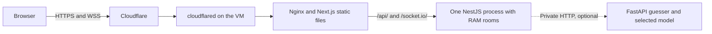

# Deployment and AI guessing plan

Implement the database-free game stack first, then enable a model service behind the same NestJS room authority. The current game commit uses PostgreSQL for its durable recovery path. The deployment files, memory profile and inference service below are the next implementation work.

## 1. Make the game deployable on one VM

Use an always-on x86-64 Ubuntu 24.04 VM chosen by the team, with Docker Engine and Compose v2. Cloudflare provides the public hostname, HTTPS and an outbound Tunnel from the VM. Cloudflare Containers would require its own Worker and container-lifecycle design. Keep the first handoff on the VM so a single process owns every live room. [Tunnel setup](https://developers.cloudflare.com/tunnel/get-started/) · [Cloudflare Containers](https://developers.cloudflare.com/containers/)



### Implementation tasks

1. Add `ROOM_STORE=memory` as the VM default and keep `ROOM_STORE=postgres` as an opt-in adapter. Implement the existing `GameStore` contract with cloned in-memory room snapshots, ordered drawing batches and atomic/idempotent turn finalization. Bound rooms and their stored batches, results and request IDs. Start with 32 rooms and a 30-minute idle expiry for rooms with no connected players, then verify cleanup and the room-limit response. Eviction clears the room timers, jobs, journals and request records together. In memory mode a process restart ends active matches and discards their records. Players can reconnect to the same process after a socket drop. For a lost room or resume token, show a clear session-ended message and clear only that room's local session and queued drawing. Keep the difference between accepted and archived ink. Label archived ink and committed scores as saved for the session in memory mode.
2. Select the store at bootstrap, with a common close hook. Validate `DATABASE_URL` only when PostgreSQL is selected. Make the current Prisma build-time configuration tolerate a missing URL so client generation and TypeScript compilation work without a database. Run migrations in the optional database setup and select that profile in its integration tests. Add a configurable `HOST` with `127.0.0.1` for existing local usage and `0.0.0.0` inside the API container. Keep `WEB_ORIGINS` set to the exact public HTTPS origin. [Prisma configuration](https://docs.prisma.io/docs/orm/reference/prisma-config-reference)
3. Add `deploy/compose.yaml`, `deploy/.env.example`, `deploy/README.md`, a preflight script, and image definitions. Build from repo root so both apps see `packages/game-contracts`. Use the repo's locked npm installs and pin the runtime images. Copy `apps/web/out` into Nginx and use the existing compiled API entry point in a separate container. Set `NEXT_PUBLIC_ROOM_TRANSPORT=remote` at build time and use same-origin HTTP and Socket.IO by leaving the public API and socket URL variables unset. Route `/api/` and `/socket.io/` through Nginx to `api:3001`, preserving paths, query strings, authorization and upgrade headers. Serve static directory indexes, including `/room/`, on `web:8080`.
4. Put `web`, `api` and `cloudflared` on the Compose network. Route `game.<team-domain>` to `http://web:8080` in the Tunnel dashboard. Keep the API and model ports on the private network. Use WebSocket upgrade forwarding and a read timeout above the Socket.IO heartbeat interval, for example 75 seconds. Bypass edge and origin caching for `/api/*` and `/socket.io/*`. Keep HTML revalidating and allow long caching of hashed static assets. Check transport recovery after an edge or socket disconnect. [Nginx WebSocket proxying](https://nginx.org/en/docs/http/websocket.html) · [Cloudflare WebSockets](https://developers.cloudflare.com/network/websockets/)
5. Add Compose health checks for the API and static server and restart policies for the core services. Use `docker compose config --quiet` and preflight checks that report missing input names. Keep tunnel and service credentials in deployment secrets outside Git. Exclude local state, environments, checkpoints, datasets and build outputs from the Docker context. Tag built images with the reviewed Git revision, record that revision in the handoff, and document switching back to the previous image pair. Update the web and API images together so the proxy resolves the current API service. A restart of the memory-profile API starts a fresh session for everyone. [Compose on a single server](https://docs.docker.com/compose/how-tos/production/)

Use Compose for VM startup and operations. Nx can later wrap existing npm scripts for task dependencies and caching. If added, keep it optional for contributors and include shared contracts, lockfiles and public build variables in cache inputs. Model serving keeps its own Python lock. [Incremental Nx setup](https://nx.dev/docs/kb/adding-to-existing-project)

### Teammate runbook to deliver

The implementation PR should leave this command sequence ready to run on a clean VM. The deployer supplies a hostname in the team's Cloudflare zone, the Tunnel credential and a reviewed revision. The default stack comes up with human play and the unavailable AI provider.

```bash
git clone https://github.com/gabnash05/more-than-meets-the-ai.git
cd more-than-meets-the-ai
git checkout <reviewed-revision>
cp deploy/.env.example deploy/.env
# Set PUBLIC_HOSTNAME and put the Tunnel credential in the documented secret location.
./deploy/preflight.sh
docker compose --env-file deploy/.env -f deploy/compose.yaml up -d --build --wait
curl --fail --show-error https://game.example.com/api/health
```

Replace `game.example.com` with the configured hostname. The runbook also needs commands for `ps`, service logs, updating to a reviewed revision and rollback. Use the Compose options above after the deployment files land. [Compose startup](https://docs.docker.com/reference/cli/docker/compose/up/)

## 2. Add the model service

Implement the service in `models/guesser/inference/` using FastAPI, Uvicorn, PyTorch and timm. Give it a CPU-compatible Linux lock and one worker that loads the selected model once at startup. Enable it as an optional Compose service named `guesser` on port 8000. Keep liveness separate from readiness. Readiness reports the loaded model ID and artifact revision and fails with an actionable reason if it cannot load the artifact. Human play starts and continues when the service is unavailable. [Guesser inference notes](../models/guesser/inference/README.md)

### Model artifacts and adapters

- First support the existing Lightning ViT-Tiny runs. A uses complete originals and B uses the partial-sketch recipe. The current backbone is `vit_tiny_patch16_224.augreg_in21k_ft_in1k` with 345 outputs. The training owner supplies the selected trusted checkpoint, exact ordered `labels.json`, `checkpoint-selection.json`, and their hashes. The selection file can contain paths from the training machine, so package it with relative artifact paths in a serving manifest. [Training handoff](../models/guesser/training/README.md)
- Record the adapter type, architecture, label hash, weight hash, preprocessing recipe and version, input shape and dependency revision in the serving manifest. Reconstruct the backbone offline with pretrained downloading disabled, load the expected state dictionary with strict shape/key validation and run in eval/inference mode. Use the selected run's deterministic foreground preprocessing and tensor normalization. Compare fixed samples with the training/evaluation input pipeline before using live drawings. If a Lightning checkpoint needs conversion, export a trusted tensor-only artifact on the training side and verify matching outputs.
- Use an adapter interface that accepts the permitted observation and returns one candidate label, a pass, or an unavailable reason. `GUESSER_MODEL_ID` selects one manifest at service startup, so the deployer can switch between A, B or another compatible adapter by changing configuration and restarting the sidecar. Mount artifacts read-only outside the image. Mount the matching ordered labels file for the API and compare its hash with model readiness. Validate the model ID and revision before the API starts an AI-eligible match.
- Lock the vocabulary intersection with the game catalogue at match start when AI is enabled. The current 348-word game catalogue has three extra words outside the 345-label ViT vocabulary. Require enough supported words for the configured rounds plus two alternatives, or leave AI unavailable for the whole match. Select prompts from the locked intersection before choosing any target. Keep the full catalogue for human-only games.

### Enable the optional profile

After copying the selected model artifact to the read-only mount, set `GUESSER_PROVIDER=http` and `GUESSER_MODEL_ID` in the VM configuration and supply the private service credential. Compose sets `GUESSER_URL=http://guesser:8000` for the API. Check readiness for the selected model before starting a new match.

```bash
docker compose --env-file deploy/.env -f deploy/compose.yaml --profile ai up -d --build --wait
```

### API boundary and pacing

1. Add a private authenticated `POST /v1/guess` endpoint and `/health/live` and `/health/ready` routes. Send a bounded PNG plus metadata in multipart form. Metadata contains the reserved `jobId`, `turnId`, `canvasId`, `generation`, canonical `sequence`, `deadlineAt`, allowed hint and pinned model ID/revision. Echo the binding in the response with `guess`, `pass`, or `unavailable`. Validate types, exact dimensions and a 4 MiB image limit. The service receives the accepted drawing and permitted hint fields. Keep the target, human guess text and player/session credentials on the game server.
2. Use the existing `GuesserProvider` reservation/acceptance boundary. Capture an immutable prefix of canonical drawing operations at the reserved sequence. Render a 1024 × 768 snapshot outside the room lock. Share the replay semantics or test parity against browser snapshots for strokes, undo, redo, clear, eraser and fill. Skip empty or unchanged observations. Keep inference I/O outside the lock and reenter the serialized room path when a result arrives. The API owns correctness, active elapsed time, accepted ordering and the existing AI score ledger.
3. Add these initial settings to the documented environment template. Validate ranges and treat the numbers as starting gameplay defaults to test on the actual VM.

| Server setting | Initial value | Purpose |
| --- | ---: | --- |
| `AI_FIRST_GUESS_MS` | 1,500 | Wait this much active drawing time before the first attempt |
| `AI_GUESS_COOLDOWN_MS` | 2,000 | Wait this long after the previous attempt settles before dispatching another |
| `AI_MAX_GUESSES_PER_TURN` | 24 | Cap dispatched attempts, including timed-out attempts |
| `AI_REQUEST_TIMEOUT_MS` | 2,500 | Cap one request further by the remaining turn time |
| `AI_MAX_CONCURRENT_JOBS` | 1 | Bound in-flight work per model role |

4. Permit one in-flight job per role. When both roles are due for the same room, reserve one canvas prefix and pass the rendered PNG to both. The Referee can also check between guesses. Count the Guesser cooldown in active drawing time, record each accepted attempt, and stop Guesser work on a correct answer. Reveal guess text and confidence with the committed recap. When a canvas clears or a turn pauses, closes, or changes generation, invalidate pending jobs. A later ink sequence alone does not invalidate a result for the recorded prefix.
5. Keep a normal pass, a cancelled job and a provider fault distinct. An eligible wrong answer can yield a scored zero; a round with no eligible answer remains unscored. A qualifying service failure leaves that evaluation unavailable. Preserve human scoring, including drawer recognition and winner selection. Log model revision, latency, skips, timeouts and job outcomes with no raw image, answer or credentials. Provide an operator switch `GUESSER_PROVIDER=unavailable` for immediate human-only recovery on a normal service update.

## 3. Delivery order and acceptance

| Gate | Done when |
| --- | --- |
| Memory profile | API builds and boots with no `DATABASE_URL`, two people complete a real match, reconnect keeps the live canvas, process restart ends the session cleanly, and room eviction releases its memory. The opt-in database suite still passes. |
| VM handoff | A teammate starts a fresh Linux VM from the runbook, reaches the public HTTPS page and health endpoint, confirms WebSocket upgrade in two independent browser sessions, completes a match, and rehearses an update and rollback. |
| AI contract | A labelled fixture service exercises exact bindings, render parity, cooldown, attempt caps, busy handling, pauses, duplicate and late responses, timeouts and safe provider disablement. |
| Trained model | The chosen checkpoint and label bundle load from the mounted artifact. Fixed-input preprocessing and predictions agree with the selected validation recipe. Two players finish a game with the real sidecar, and the team records observed latency and availability on its VM. |

Keep the first deployment focused on human play. A teammate can deploy the base stack as soon as the first two gates pass, then enable the AI profile when the model artifact and the final two gates are ready. Use the existing Individual game tests and test the public origin through Cloudflare before handoff. Keep the model-serving comparison and the controlled research evaluation as separate records.
